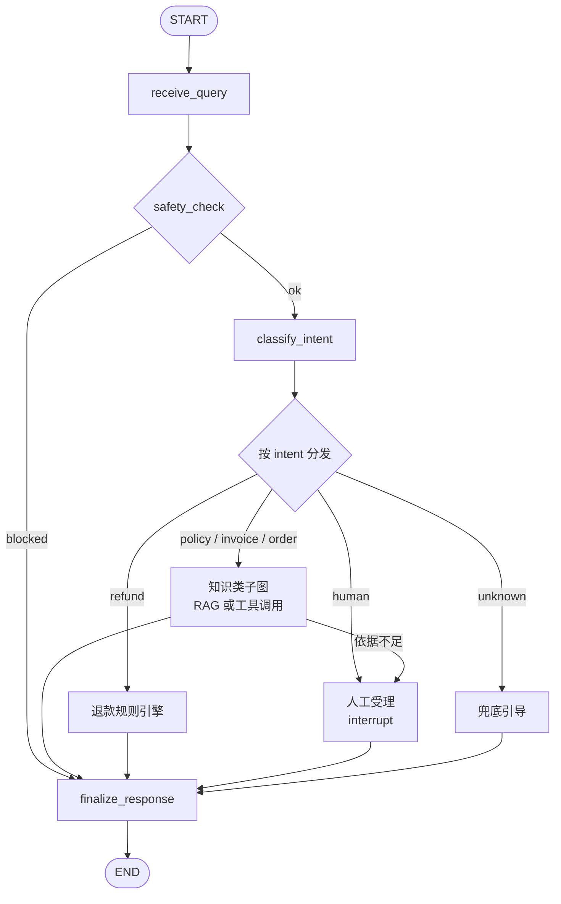
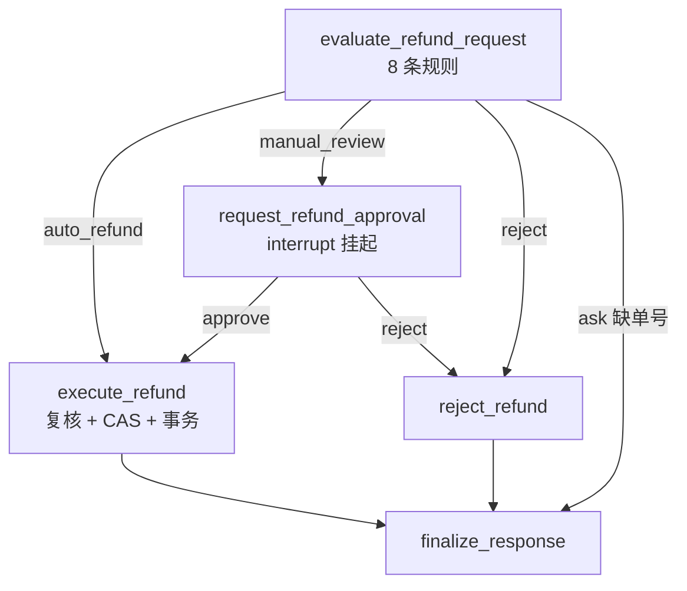
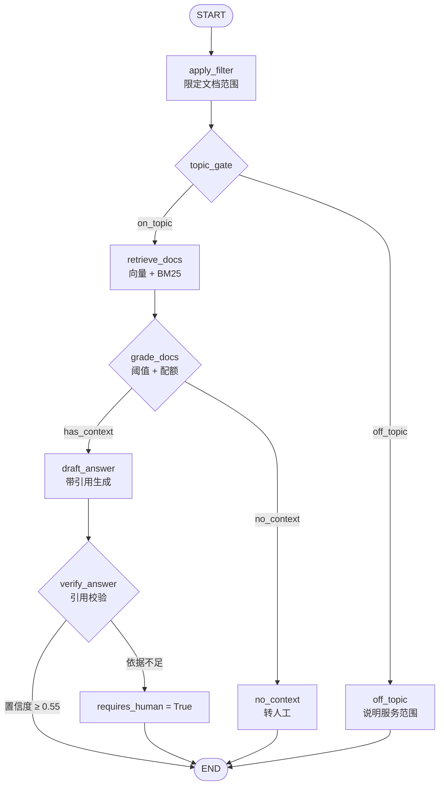
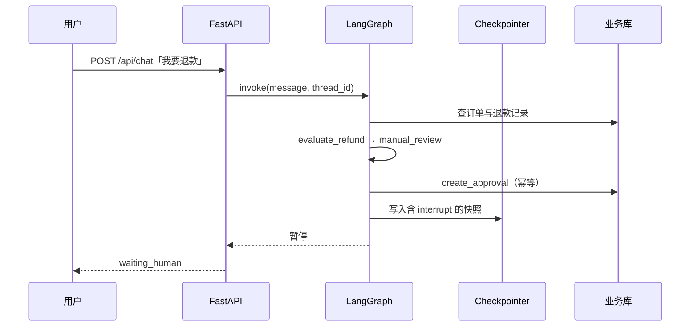
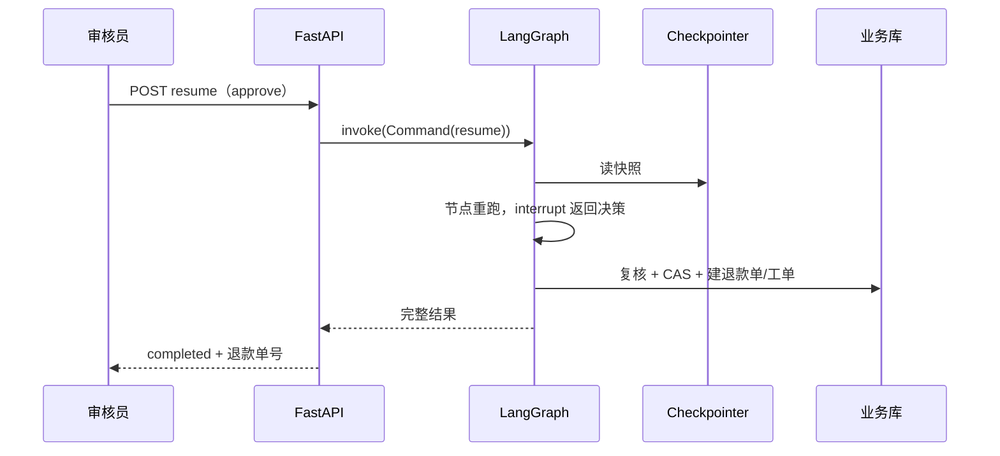

# 售后支持 Agent · 项目讲解

> 版本 v2.0（2026-10-29）　规模：后端 5613 行 Python / 前端 3449 行 TS+Vue / 111 个测试
> 读完你应该能：讲清每个设计取舍、答上追问、动手改任何一层。

---

## 目录

1. [项目定位：做什么、不做什么](#1-项目定位做什么不做什么)
2. [成熟度自评（含短板）](#2-成熟度自评含短板)
3. [架构与主图](#3-架构与主图)
4. [一次请求的完整生命周期](#4-一次请求的完整生命周期)
5. [代码地图](#5-代码地图)
6. [LangGraph 的六个关键词](#6-langgraph-的六个关键词)
7. [主图逐节点](#7-主图逐节点)
8. [意图路由：三层 + 三类误判](#8-意图路由三层--三类误判)
9. [RAG 全链路（含两组评估指标）](#9-rag-全链路含两组评估指标)
10. [退款规则引擎](#10-退款规则引擎)
11. [人工审批与中断恢复](#11-人工审批与中断恢复)
12. [认证与授权](#12-认证与授权)
13. [质量工程：测试 / CI / 覆盖率 / 压测 / 指标](#13-质量工程测试--ci--覆盖率--压测--指标)
14. [安全审计：3 个 P0 的复现与修复](#14-安全审计3-个-p0-的复现与修复)
15. [踩坑复盘](#15-踩坑复盘)
16. [性能与容量](#16-性能与容量)
17. [已知限制与下一步](#17-已知限制与下一步)
18. [面试怎么讲](#18-面试怎么讲)
19. [二次开发](#19-二次开发)
20. [术语与速查](#20-术语与速查)

---

## 1. 项目定位：做什么、不做什么

### 1.1 三个真实痛点

| 痛点 | 纯 RAG 问答 | 本项目 |
| --- | --- | --- |
| 政策不可追溯 | 说"7 天"，问出处答不上 | 每条结论带 `[1][2]`，来源卡片可展开原文与打分 |
| 退款资格靠"感觉" | 同一单问两次结论可能不同 | 8 条规则用代码判定，输出结构化 `PolicyDecision` |
| 跨时段流程断掉 | 审核 2 小时，会话早没了 | `interrupt()` 挂起 + Checkpointer，`Command(resume)` 恢复，不重复退款 |

### 1.2 它明确不是什么

- 不是多租户 SaaS：没有租户隔离，只有单库演示；
- 不是生产级认证体系：有 JWT+RBAC，但缺 refresh token / 吊销 / 登录审计表；
- 订单/支付是 SQLite 模拟数据，不是真实 OMS；
- 政策文档是自建示例（按真实电商售后流程抽象），不是客户真实语料。

**能主动划边界，比吹"什么都能做"更可信。**

---

## 2. 成熟度自评（含短板）

| 维度 | 分数 | 依据 | 短板 |
| --- | --- | --- | --- |
| 业务建模 | 8/10 | 8 条规则、审批状态机、金额分摊、签收争议 | 不支持部分退款/换货补差 |
| 工程规范 | 8/10 | 五层分层、配置外置、无裸 SQL、降级矩阵 | —— |
| 测试 | 8/10 | 111 个用例、语句覆盖 67.5%、6 条 IDOR 回归 | 无前端单测、无 E2E 进 CI |
| 效果评估 | 7/10 | 检索 + 答案两套标注集，指标可回归 | 只有 36/26 条，样本偏小 |
| 可观测性 | 6/10 | request_id + `/api/metrics`（p50/p95/p99） | 未接 OTel/LangSmith，无告警 |
| 性能 | 5/10 | 有压测与瓶颈结论 | 单实例、SQLite 写锁、无容量规划 |
| 协作 | 4/10 | CI + Makefile + 文档 | 单人项目，无 PR/评审流程 |

一句话：**工程质量与业务深度够，缺的是真实流量和多人协作痕迹。**

---

## 3. 架构与主图

### 3.1 分层

```
┌──────────────────────────────────────────────────────────┐
│ 前端  Vue 3 + Vite + Pinia + TypeScript                   │
│   登录 / 对话工作台 / 人工审核台 / 知识库调试台             │
└───────────────┬──────────────────────────────────────────┘
                │ HTTP + SSE（Bearer JWT）
┌───────────────▼──────────────────────────────────────────┐
│ 接口层  FastAPI（app/api）                                 │
│   鉴权依赖 / request_id / 指标 / 登录限流 / 异常映射        │
├──────────────────────────────────────────────────────────┤
│ 服务层  SupportService（app/graph/service.py）             │
│   把"图"包装成"会话"：chat / stream / resume / history      │
├──────────────────────────────────────────────────────────┤
│ 编排层  LangGraph 主图（13 节点，6 条意图分支，2 处中断）    │
├──────────────────────────────────────────────────────────┤
│ 能力层  知识子图（RAG）· 订单子图 · 退款规则 · 人工受理      │
├──────────────────────────────────────────────────────────┤
│ 基础设施  FAISS · SQLite · Checkpointer(SQLite/PG)         │
│          LLM: DeepSeek（可 mock）· Embedding: 千问 v3       │
└──────────────────────────────────────────────────────────┘
```

原则：**上层不感知下层细节**——接口层不知道 `interrupt`，服务层不写 SQL，图节点里没有裸 SQL，规则引擎不碰 LLM。

### 3.2 主图：入口与路由



### 3.3 主图：退款支线



真实图可从代码导出：

```bash
cd backend && PYTHONPATH=. python -c "
from langgraph.checkpoint.memory import MemorySaver
from app.graph.builder import build_graph
print(build_graph(checkpointer=MemorySaver()).get_graph().draw_mermaid())"
```

---

## 4. 一次请求的完整生命周期

以 **"订单 SO202610180001 我要退款，耳机有杂音"** 为例：

```
① 前端 store.send(text) → POST /api/chat/stream  (Bearer JWT)
② 中间件：生成 request_id、开始计时
③ 鉴权：require_user → CurrentUser(alice, customer, C1001)
④ 会话归属：thread 已存在且不属于 alice → 404；新建则放行
⑤ 图执行（SSE 逐节点推送）：
   receive_query → safety_check（PII/注入）→ classify_intent（refund 0.88, deterministic）
   → evaluate_refund_request
        repo.get_order → 归属校验（C1001 == C1001 ✓）
        R1~R7 全量求值 + R9 签收争议 + 金额分摊 → manual_review / R8_MANUAL_REVIEW
        政策引用按"规则 → 文档"映射召回
   → request_refund_approval：先查 pending（幂等）→ 建审批单 → interrupt 挂起
⑥ 返回 status=waiting_human + pending_review（金额、规则明细、金额构成、引用）
⑦ 审核员（agent01）在审核台通过：POST /threads/{id}/resume {approve, note}
⑧ 图恢复：request_refund_approval 节点重跑 → 幂等命中 → interrupt 立刻返回决策
   → execute_refund：重读订单 → 复跑规则 → 金额比对 → CAS 抢审批单 → 单事务写退款单+工单
⑨ finalize_response 写 AIMessage；前端渲染退款单号、工单号、审核备注
```

**三个最容易讲错的点**：

1. `interrupt` 不是抛异常退出，而是把状态存进 Checkpointer 后暂停；
2. 恢复时**该节点从头重跑**，所以 `interrupt` 之前的副作用必须幂等；
3. `resume` 只需要 `thread_id` + 决策，上下文在快照里。

---

## 5. 代码地图

```
backend/app/
├── main.py                    工厂 / lifespan / request_id 中间件 / 指标 / 启动守卫
├── deps.py                    repo·retriever·llm 进程级单例
├── core/                      config · logging · metrics · ratelimit · context · errors
├── llm/client.py              LLM 薄封装：失败返回 ""，由上层降级
├── rag/
│   ├── chunking.py            标题感知切片（表格不被切断）
│   ├── embeddings.py          Hashing / OpenAI 兼容（千问 v3）
│   ├── bm25.py                中文二元组 BM25
│   ├── store.py               FAISS + 原子落盘 + 签名校验
│   ├── retriever.py           融合打分 / 表格加成 / 单文档配额 / BM25 降级
│   └── ingest.py              重建 + 冷启动自动重建
├── domain/
│   ├── security.py            ★ 口令哈希 / JWT 签发校验 / 角色权限表
│   ├── policy.py              ★ 8 条规则 → PolicyDecision（含 breakdown）
│   ├── repository.py          ★ SQLite：订单/退款/工单/审批/用户/会话归属 + 事务/CAS
│   └── models.py
├── agents/
│   ├── knowledge.py           ★ RAG 子图（8 节点，含主题闸门）
│   ├── refund.py              ★ 评估 / 审批 / 执行 / 驳回
│   ├── order.py               查单子图（含归属校验）
│   ├── human.py               人工受理（interrupt + 工单 + CAS 认领）
│   ├── wrappers.py            ★ 子图 → 父图节点（防 trace 重复）
│   └── common.py              trace / 抽取式回答 / 引用校验 / 归属判定
├── graph/
│   ├── state.py               SupportState（含 actor_role）
│   ├── classifier.py          ★ 词表 + 规则 + LLM 兜底
│   ├── builder.py             主图装配
│   ├── checkpointer.py        memory / sqlite / postgres
│   └── service.py             ★ 会话语义（含孤儿会话防接管）
└── api/                       routes · schemas · deps_auth
```

★ 是面试只需讲的 6 个文件。

---

## 6. LangGraph 的六个关键词

| 概念 | 在本项目里的样子 |
| --- | --- |
| **State** | `SupportState` TypedDict；`trace`/`messages` 用 `Annotated[..., reducer]` 做累加 |
| **Node** | `state -> dict`；返回要更新的字段 |
| **Conditional edge** | `route_by_intent` 返回 intent 字符串，`path_map` 映射到节点名 |
| **Subgraph** | knowledge / order / invoice 三个子图，经 `make_subgraph_node` 包装成父图节点 |
| **Checkpointer** | memory（测试）/ sqlite（本地默认）/ postgres（compose） |
| **interrupt / Command** | 退款审批、人工接管两处；恢复时节点重跑 |

子图包装的关键一行（防 trace 重复）：

```python
sub_input = {k: v for k, v in state.items() if k != "trace"}  # messages 要留着做多轮检索
result = graph.invoke(sub_input)
steps = result.pop("trace", []) or []
result.pop("messages", None)
return {**result, "trace": steps}
```

---

## 7. 主图逐节点

| 节点 | 职责 | 分支/失败行为 |
| --- | --- | --- |
| `receive_query` | 写入 HumanMessage | — |
| `safety_check` | 注入词、超长截断、身份证/卡号/手机号脱敏 | blocked → 直接 finalize |
| `classify_intent` | 词表 + 规则 + LLM 兜底 | 判不出 → unknown |
| `knowledge_workflow` | RAG 子图 | 依据不足 → escalate → 人工 |
| `invoice_workflow` | RAG（限 04/02 文档） | 同上 |
| `order_workflow` | 查单 + 归属校验 | 越权 → 按"未找到"处理 |
| `evaluate_refund_request` | 规则 + 政策引用 + 归属校验 | 缺单号 → ask |
| `request_refund_approval` | 幂等建单 + `interrupt` | 恢复后走 execute / reject |
| `execute_refund` | 复核 → CAS → 单事务落账 | 冲突/重复 → 中止并说明 |
| `reject_refund` | 驳回文案 + 关审批 + 工单 | 抢占失败 → 提示已被处理 |
| `human_support` | `interrupt` 等人工，CAS 认领后建工单 | — |
| `fallback_workflow` | 意图不明时给可点下一步 | — |
| `finalize_response` | 补默认建议、写 AIMessage | 唯一出口 |

---

## 8. 意图路由：三层 + 三类误判

### 8.1 三层结构

1. **词表打分**：`INTENT_LEXICON` 命中累加权重（`转人工` 4.0 必须压倒一切，`订单` 只给 2.0）。
2. **规则纠正**：四类硬规则——明确要人工 → human；执行词（"我要退款"）→ refund；有单号 + 退换动作 → refund；咨询句式 → policy。
3. **LLM 兜底**：仅 `unknown && confidence < 0.5` 时调用，返回 JSON 并过白名单。

### 8.2 咨询 vs 执行（最容易翻车）

> "能退货吗"如果被判成 refund，用户会被直接拉进退款流程。

```python
QUESTION_WORDS = ("吗", "?", "怎么", "多久", "什么时候", "哪些", "需要什么", ...)
DOMAIN_WORDS   = ("退", "换", "运费", "时效", "发票", "保修", "发货", "无理由", ...)
# 咨询句 + 领域词 → policy
```

### 8.3 评估集暴露的三类误判（已修）

第一次跑答案评估时 20 条可回答问题里 5 条被拒答，查下来全是路由问题：

| 现象 | 根因 | 修法 |
| --- | --- | --- |
| "七天无理由从什么时候开始算"被判"不在售后范围" | 主题词表只有"退货/发票/维修"，不含"无理由/七天/专票/寄修" | 词表补 18 个真实说法 |
| "什么情况必须转人工"直接挂起等人 | `wants_human` 命中"转人工" | 加 `HUMAN_RULE_QUESTION` 正则，问句 → policy |
| "付款后多久发货"答成了订单详情 | "发货"在 order 词表、`DOMAIN_WORDS` 缺"发货" → 不走咨询 | 领域词补"发货/无理由/维修/包邮" |

修完：可回答题的拒答率 5% → **0%**（详见 §9.5）。

---

## 9. RAG 全链路（含两组评估指标）

### 9.1 子图



子图不负责中断，只把 `requires_human` 交回父图——中断点集中、好维护。

### 9.2 切片与向量化

- **标题感知**：按 `##/###` 切，切片带 `title + section`；**表格作为整体块**装箱，避免"时效表"被切两半；
- 参数：`chunk_size=420`、`overlap=80`，6 篇 → **46 个切片**；
- 两种 embedder：本地 hashing（768 维，零依赖、可离线）与 OpenAI 兼容（千问 `text-embedding-v3`，1024 维，单批 ≤10）。

### 9.3 存储

`vectors.npy + chunks.json + meta.json`，加载校验维度与 embedder 签名，不一致自动重建。**落盘用临时文件 + `os.replace` 原子替换**，崩溃不会留半截索引（不再用 pickle）。

### 9.4 混合检索

```python
fused = 0.6 * vector_score + 0.4 * keyword_norm
if asks_timing and "| ---" in chunk.text:  # 问"多久/时效"
    fused += 0.06
```

为什么不用 RRF：RRF 只用排名、丢掉置信度，无法直接做阈值；本项目需要"低于阈值就转人工"。

实测区分度（千问 v3 / 46 切片 / 阈值 0.40）：相关 0.49~0.94，无关 0.18~0.25。

### 9.5 两套评估（都可回归）

**检索评估**（36 条：28 可回答 + 8 无关）：

| 指标 | 数值 |
| --- | --- |
| recall@1 / @3 / @5 | **0.964 / 1.000 / 1.000** |
| section@1（引对段落） | **1.000** |
| MRR | **0.976** |
| 误召率（只看检索） | 0.250（"股票开户""公司地址"蹭到"开户行""地址"） |
| 前置闸门拦截率 | **1.000**（这两条端到端进不到检索） |

**答案评估**（26 条：20 可回答 + 6 无关，跑整条 `/api/chat`）：

| 指标 | 修复前 | 修复后 |
| --- | --- | --- |
| 引用命中 citation_accuracy | 0.750 | **1.000** |
| 事实覆盖 fact_coverage | 0.750 | **1.000** |
| 有依据回答 grounded_rate | 0.700 | **1.000** |
| 可回答题被转人工 | 0.050 | **0.000** |
| 拒答准确 refusal_accuracy | 1.000 | **1.000** |
| 硬答率 false_answer_rate | 0.000 | **0.000** |
| 延迟 p50 / p95 | 1.71 / 2.96s | 2.30 / 3.08s |

> 修复前后差异来自 §8.3 的三类误判，不是换模型。

### 9.6 生成与校验

prompt 五条硬约束（只能用资料、必须标 `[n]`、资料没有就说"未覆盖"、先结论后步骤、不复述原文）。

```python
confidence = 0.4 * min(1.0, top_score * 1.6) + 0.6 * verification_score
if confidence < 0.55 or not has_citation: requires_human = True
```

`verify_citations` 只保证"有引用 + 编号合法 + 覆盖率"，**防不住引用错位**——这是一条要主动承认的边界。

---

## 10. 退款规则引擎

| 规则 | 检查 | 不通过 |
| --- | --- | --- |
| R1 | 订单存在 | `R1_ORDER_NOT_FOUND` 拒绝 |
| R2 | 状态可退（paid/shipped/delivered） | `R2_ORDER_STATUS` |
| R3 | 商品类型（虚拟 / 定制） | `R3_*` |
| R4 | 时效（无理由 7 天 / 质量 15 天，从签收算） | `R4_OUT_OF_WINDOW` |
| R5 | 是否已有进行中退款 | `R5_DUPLICATE` |
| R6 | 金额 ≤ 自助上限 ¥300 | 超 → 审批 |
| R7 | 30 天内退款 < 3 次 | 达到 → 审批 |
| R9 | 签收争议（主张没收到 + 已签收） | 强制人工，需调签收底单 |

**全量求值不短路**：拒绝时一次说清踩了哪几条（`failed_rules`），审批单里展示全部 `checks`。

**金额核算**：`实付 − 应承担运费`。质量退全款（运费平台承担），无理由扣运费；输出 `breakdown`（标价/优惠/运费/实付/应退）供对账。演示订单：329 − 50 + 8 = 287，无理由退 **279**。

**为什么不让模型判**：一致性、可测（9 个单测精确断言）、可审计、零 token。模型的角色被压缩成"把结论翻译成人话"。

---

## 11. 人工审批与中断恢复

### 11.1 两段时序

**申请 → 挂起**



**审核 → 恢复**



### 11.2 四道防线

1. **幂等键** `(thread_id, order_no)`：恢复时先查 pending，命中就复用；
2. **CAS**：`UPDATE approvals SET status=? WHERE approval_id=? AND status='pending'`，影响行数 = 1 才继续；
3. **单事务 + 部分唯一索引**：`commit_refund` 内 `BEGIN IMMEDIATE`；`refunds(order_no) WHERE status IN ('pending','approved')` 唯一；
4. **TOCTOU 复核**：执行前重读订单、复跑规则、比对金额，不一致中止。

对应测试：`test_claim_approval_is_atomic`（8 线程只 1 个成功）、`test_sequential_double_resume_only_refunds_once`、`test_commit_refund_rolls_back_when_approval_taken`、`test_execute_revalidates_order_state`。

---

## 12. 认证与授权

```
POST /auth/login → PBKDF2 校验（84ms）→ HS256 JWT {iss,sub,role,cid,iat,exp,jti}
每个请求 → require_user / require_permission(...)
        ├─ 401 无令牌/过期/签名错/alg 不符/iss 不符
        └─ 403 角色缺权限点
业务侧   ├─ ABAC：agent 审批 > ¥5000 → 403（需 admin）
        └─ 数据归属：订单 customer_id、会话 thread_owners
```

| 角色 | 权限点 |
| --- | --- |
| customer | `chat:own` `orders:own` `tickets:own` |
| agent | + `orders:read` `tickets:read` `reviews:read` `reviews:decide` `knowledge:read` `knowledge:search` |
| admin | `*`（含 `knowledge:write`、`users:read`、`metrics:read`） |

校验细节：`algorithms=["HS256"]` 白名单（防 `alg=none`/算法混淆）、`issuer` 强校验、`require=["exp","iat","sub","iss"]`、30s 时钟漂移、`jti` 预留吊销能力；口令 PBKDF2-HMAC-SHA256（210k 轮 + 每用户随机盐）；账号不存在也跑一次 dummy 哈希，抹平登录时序。

**为什么"A 认证"不够**：见 §14——认证解决"你是谁"，归属校验才解决"这条数据是不是你的"。

---

## 13. 质量工程：测试 / CI / 覆盖率 / 压测 / 指标

### 13.1 测试分布（111）

```
test_api.py           20   接口：鉴权、SSE、409/403/404、指标、审批身份取自令牌
test_auth.py          14   口令哈希、令牌过期/篡改/alg-none/换 issuer、权限矩阵
test_classifier.py    17   9 组意图参数化 + 实体抽取 + 三类误判回归 + 主题闸门
test_graph_flows.py   15   端到端图流程（自助/审批/驳回/转人工/注入/忙线程）
test_hardening.py     14   并发 CAS、事务回滚、TOCTOU、R9、金额分摊、多轮、脱敏
test_observability.py  8   限流窗口、登录 429、指标渲染与鉴权、转人工计数
test_ownership.py      6   IDOR：跨客户退款/查单、会话写入、孤儿会话接管
test_policy.py         9   8 条规则与组合
test_rag.py            8   向量确定性、表格召回、越界、引用字段
                     ────
                      111
```

三个"守卫型"不变量：**子图 trace 不重复**、**审批恢复只执行一次**、**无关问题过不了阈值**。

### 13.2 CI

`.github/workflows/ci.yml`：后端 `pytest`（mock 模式）+ `scripts/smoke.py`；前端 `npm ci` + `vue-tsc --noEmit` + `vite build`。

### 13.3 覆盖率

`make cov`（stdlib `trace` 自实现，不依赖 pytest-cov）：**语句覆盖 67.5%**。

policy / repository / security / classifier / service / builder / types **100%**；`embeddings.py`、`chunking.py` 偏低（真实 embedding 与切片边界不在单测里）；`config/schemas/models/state` 这类"只含声明"的文件在此口径下显示 0%（导入早于追踪），属于口径盲区。

### 13.4 压测（stdlib 脚本，无外部依赖）

| 场景 | 并发 | 请求 | 成功率 | RPS | p50 | p95 |
| --- | --- | --- | --- | --- | --- | --- |
| 订单链路（无 LLM） | 1 | 10 | 100% | 1.66 | 0.53s | 0.88s |
| 订单链路 | 20 | 100 | 100% | 11.8 | 1.53s | 2.39s |
| 政策链路（LLM） | 5 | 10 | 100% | 0.84 | 4.22s | 6.93s |

**瓶颈结论**：政策链路由 LLM 决定（4~7s）；订单链路单并发 0.53s，20 并发涨到 1.53s——**SQLite checkpointer 的写锁竞争**，不是业务逻辑。生产换 PostgreSQL checkpointer + 多实例。

### 13.5 指标与限流

`/api/metrics`（Prometheus 文本，admin）：`http_requests_total{method,path,status}`、`http_request_duration_seconds` + p50/p95/p99、`chat_turns_total{intent}`、`escalations_total{intent}`、`degraded_turns_total`、`login_rate_limited_total`。

登录限流：`IP + username` 滑动窗口 10 次 / 5 分钟 → 429 + `Retry-After`。

---

## 14. 安全审计：3 个 P0 的复现与修复

> 认证上线后做了一轮双账号攻击式自测，发现**"只校验你是谁，没校验数据是不是你的"**。

| # | 漏洞 | 修复前实测 | 修复后 |
| --- | --- | --- | --- |
| A | 客户用**别人的订单号**发起退款/查单 | bob 用 alice 的 `SO202610270007` → **200，¥279 退款单落库** | "没有查到这笔订单"；退款单 0；客服代查仍可用 |
| B | 客户往**别人的会话**写消息 | bob 向 alice 的 `thread_id` 发消息 → **200**，写进 alice 会话 | 404；alice 会话条数不变 |
| C | **无归属历史会话**可读、可被首条消息接管 | `GET` 认证前会话 → **200 + 2 条历史** | 客户 404；发消息 404 且 owner 不被改写 |

修法要点：

- `SupportState.actor_role` 贯穿，`is_foreign_order()` 在**规则判定之前**拦截；客服/管理员豁免（有 `orders:read`）；
- 路由层 `_assert_thread_access()`：客户只能碰自己的会话，越权统一 404（不暴露存在性）；
- `ThreadForbiddenError`：拒绝"有状态但无归属"的会话被接管。

回归测试：`test_customer_cannot_refund_other_customers_order`、`..._read_other_customers_order`、`..._write_into_other_thread`、`..._take_over_orphan_thread`、`test_unowned_thread_is_invisible_to_customers`、`test_staff_can_query_any_order`。

**这段经历比"我做了 JWT+RBAC"值钱**：它说明会自己找自己的洞。

---

## 15. 踩坑复盘

| # | 现象 | 根因 | 修法 |
| --- | --- | --- | --- |
| 1 | `KeyError`，路由函数返回节点名 | `add_conditional_edges` 的 `path_map` 是"返回值 → 节点" | 路由只返回 intent |
| 2 | 时间线节点重复两遍 | 子图继承父图 `trace`，返回后父图 reducer 再追加 | 包装层摘掉 `trace` |
| 3 | 一次审批生成两笔退款 | `interrupt` 恢复时节点重跑，`create_approval` 执行两次 | `_ensure_approval` 先查后建 |
| 4 | AI 气泡一直空白 | 改的是 push 进数组的**原始对象**，不触发 Vue 响应 | 通过数组取代理再改 |
| 5 | 换真模型后阈值失效 | 0.24 是为哈希向量调的 | 重标 0.40 + meta 签名校验 |
| 6 | 建索引 400 | 千问 embedding 单批 ≤10 | 批大小可配 + 429 退避 + 按 index 排序 |
| 7 | 超期拒绝却引用《审批流》 | 用用户原话检索，噪声大 | 规则 → 文档映射 + 规则专属问句 |
| 8 | 索引加载用 pickle | `allow_dangerous_deserialization` 等于 RCE 入口 | 改 npy/json + 原子写 |
| 9 | 驳回后待审队列不清 | 驳回只建工单、没关审批单 | `claim_approval(rejected)` |
| 10 | 并发审批退两笔 | check-then-act 竞态 | CAS + 唯一索引 |
| 11 | 5 条售后问题被拒答 | 主题词表太窄 / 问句被当执行 | 词表扩 18 项 + 咨询规则（§8.3） |
| 12 | 3 个 IDOR | 只校验身份，没校验归属 | 订单/会话归属校验（§14） |

---

## 16. 性能与容量

| 环节 | 耗时 | 说明 |
| --- | --- | --- |
| 建索引（46 切片） | 2.7s | 5 批 embedding |
| 单条 query 向量化 | 0.2~0.3s | 1 次 embedding |
| 混合检索 | <10ms | 内存计算 |
| 政策问答一轮 | 2.3s（p50）/ 3.1s（p95） | 检索 + 生成（DeepSeek） |
| 订单查询一轮 | 0.53s（单并发） | 无 LLM；主要是 checkpointer 多次写 |
| 审批恢复 | <0.5s | 无 LLM |

可优化（按收益排序）：

1. 换 PostgreSQL checkpointer / 减少每步快照写入 → 订单链路 p50 有望回到 0.1s 级；
2. token 级流式 → 首字延迟从 2~7s 降到 <1s；
3. query 向量缓存 + 同问结果缓存；
4. rerank（top50 → top6）修掉评估里剩下的错位样本。

---

## 17. 已知限制与下一步

| 限制 | 影响 | 下一步 |
| --- | --- | --- |
| 单实例 + SQLite checkpointer | 并发写锁，p50 翻 3 倍 | 换 PG checkpointer，多实例 |
| 无 refresh token / 吊销 | 离职后旧 token 8 小时内有效 | Redis 黑名单 + refresh |
| token 存 localStorage | XSS 可窃取 | HttpOnly Cookie + CSRF |
| 不支持多意图 | 一句话两件事只处理主诉求 | 多标签分类 + 并行子图 |
| 知识库无文档级权限 | 内部文档谁问都能召回 | 切片带 visibility + 检索后过滤 |
| 只有阶段流式 | 首字延迟高 | token 级流式 |
| 评估集偏小（36/26） | 指标方差大 | 扩到 100+，加 hard negative |

---

## 18. 面试怎么讲

**90 秒**

> 我做了个售后支持 Agent：LangGraph 编排 13 个节点，先把问题分到政策/订单/退款/投诉四条子图。政策类走 FAISS+BM25 混合检索，每条结论带引用，引用校验不过就转人工；退款类不走模型，8 条规则判资格，金额超阈值会 `interrupt` 挂起等人工，审批完 `Command(resume)` 恢复并落工单。111 个测试、语句覆盖 67.5%，检索 recall@1 0.964、答案有依据率 1.0，20 并发压测 0 错误。

**3 分钟**：问题（三个痛点）→ 方案（路由 / RAG 校验 / 规则引擎 / 审批恢复 / 认证授权）→ 代价（幂等负担、SQLite 写锁、评估集规模）。

**高频追问**（详细答法见题库）：

| 追问 | 一句话 |
| --- | --- |
| 这算 Agent 吗？ | 可控的 agentic workflow，模型只在两处参与 |
| 怎么证明答得对？ | 两套评估：检索 recall@1 0.964、答案有依据率 1.0，脚本可回归 |
| 能扛多少并发？ | 20 并发 100 请求 0 错误；瓶颈是 SQLite 写锁和 LLM，不是逻辑 |
| 最难的？ | 中断恢复的幂等——不报错，悄悄多写一条数据 |
| 有什么坑？ | 3 个 IDOR：认证解决了"你是谁"，没解决"数据是不是你的" |

---

## 19. 二次开发

| 需求 | 改哪里 |
| --- | --- |
| 换知识库 | 替换 `knowledge_base/*.md` → `make index` |
| 加业务子图 | 新建 `agents/xxx.py` → `builder.add_node` + `INTENT_ROUTES` + 分类词表 + 2 个测试 |
| 接真实 OMS | 只改 `domain/repository.py`（SQL → HTTP） |
| 换向量模型 | 改 `.env` → `make index` → 重标 `RETRIEVAL_MIN_SCORE` |
| 加规则 | `domain/policy.py` 加 RuleCheck + `RULE_DOC_HINTS` + 单测 |
| 换审批人体系 | `security.py` 的 `ROLE_PERMISSIONS` + 审批金额阈值 |

---

## 20. 术语与速查

| 术语 | 一句话 |
| --- | --- |
| Checkpointer | 每步存状态快照，用于恢复/回放/中断 |
| interrupt | 节点内暂停，恢复时该节点从头重跑 |
| 子图 | 编译好的图当节点用，隔离领域子流程 |
| 混合检索 | 向量 + BM25 加权融合 |
| 相关性闸门 | 阈值过滤，宁可不答也不给错依据 |
| 引用校验 | 检查 `[n]` 是否真实存在、覆盖率多少 |
| 幂等 | 同一操作执行多次结果一致（先查后建 + CAS） |
| ABAC | 属性级授权：角色之外再看金额 |
| IDOR | 越权访问对象：改个 id 就能读别人的数据 |

**一页速查**

```
启动：make install → make index → make dev-backend && make dev-frontend
测试：make test（111）· make cov（67.5%）· make eval / eval-answer · make loadtest
账号：alice/bob = 客户，agent01 = 审核员（≤¥5000），admin = 管理员，密码 demo1234
关键文件：domain/policy.py · domain/security.py · agents/knowledge.py · agents/refund.py
         agents/wrappers.py · graph/service.py
三个不变量：trace 不重复 · 审批只执行一次 · 无关问题过不了阈值
关键参数：chunk 420/80 · top_k 6 · max_per_doc 3 · 阈值 0.40（真向量）/0.24（哈希）
         退款上限 ¥300 · 无理由 7 天 · 质量 15 天 · 频次 3 次/30 天 · 审核员上限 ¥5000
```
